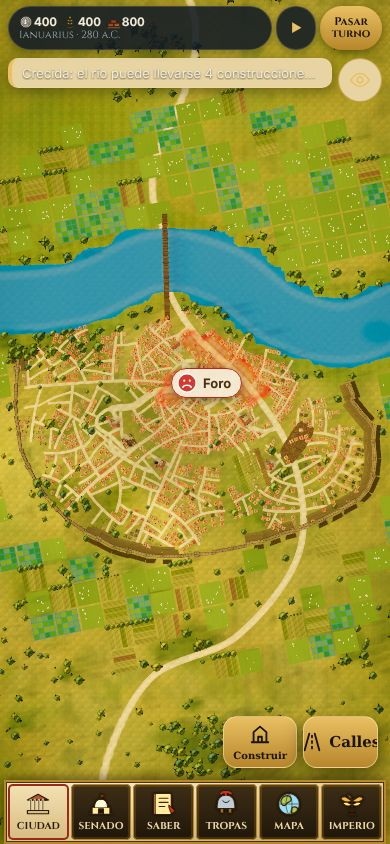
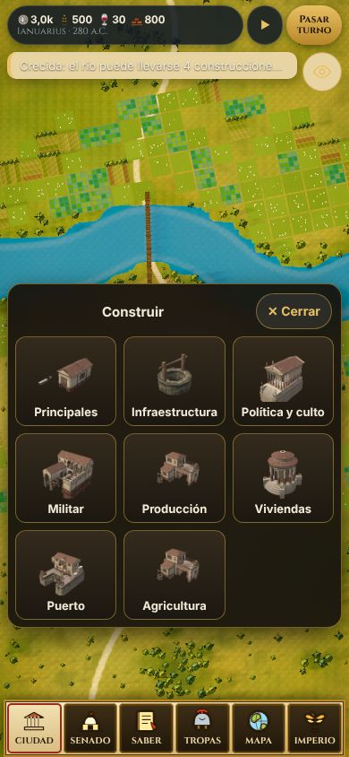
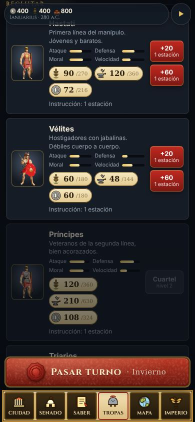
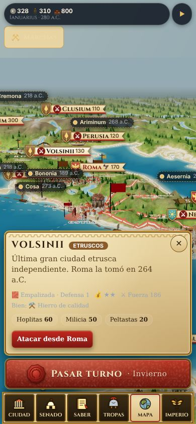
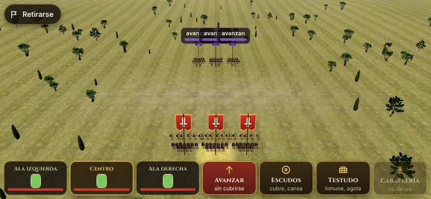
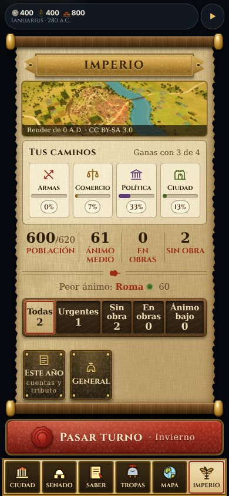

# Cómo jugar a AQVILA · mini guía

*Versión v164 · 24/11/2026. Capturas reales a 390 px en `gobierno/guia/`.*

## Qué es

Eres Roma en el año 280 a.C. Haces crecer tus ciudades, ganas apoyos en el Senado, comercias y haces la guerra.
Las batallas se ven en 3D y las diriges tú con el dedo.

## Cómo se gana

Hay **cuatro caminos**. Ganas cuando cumples **tres**. No hay plazo de años.

- **Armas**: tomar Cartago y plazas enemigas.
- **Comercio**: reunir 3.000 denarios, abrir rutas y firmar acuerdos.
- **Política**: ser Príncipe del Senado y tener el apoyo de los bandos.
- **Ciudad**: tener los barrios bien atendidos y que Roma llegue a «Urbs».

Los ves en **Imperio › Tus caminos**. Un camino logrado se pierde si deja de cumplirse 3 meses. Si cae Roma, pierdes.

## Los primeros 10 minutos

1. **Empieza.** En el menú, «Empezar la campaña» y lee la carta del año 280. Pulsa «Continuar».

2. **Mira la ciudad.** Arriba tienes los denarios, el grano y los materiales. Si un barrio sale con cara triste, tócalo: te dice qué le falta.
3. **Construye.** Botón redondo **Construir**. Elige un grupo (Infraestructura, Viviendas, Agricultura…) y un edificio. Con **Calles** trazas una calle con el dedo.
   
4. **Comida.** El grano da de comer al pueblo y a las tropas. En Construir › **Agricultura** pones campos: trigo, huerto, pasto; más tarde olivar y viña.
5. **Recluta.** Pestaña **Tropas**, baja hasta «Reclutar» y pulsa **+20** en Hastati. Tardan una estación.
   
6. **Ataca.** Pestaña **Mapa**. Toca una ciudad enemiga vecina (las que tienen ✕). Mira su «Fuerza» y pulsa **Atacar desde Roma** › **¡A las armas!**
   
7. **Pasa el tiempo.** **Pasar turno** salta a la estación siguiente; ▶ deja correr el tiempo.
8. **La batalla.** Cuando llega tu ejército: **Ir al choque** para dirigirla, o **Delegar en tus tribunos** para que se resuelva sola.
9. **Dirige.** Pon el móvil en horizontal. Toca un cuerpo (Ala izquierda, Centro, Ala derecha) y luego una orden: Avanzar, Escudos o Testudo. Si va mal, **Retirarse**.

## Las pestañas de abajo

- **Ciudad**: tu ciudad vista desde arriba. Construir y Calles.
- **Senado**: votaciones, bandos, tu carrera, fiestas, el plan de obras y los ministros.
- **Saber**: la ciencia. Abre edificios, cultivos y tropas nuevas.
- **Tropas**: tu guarnición, las clases sociales y el reclutamiento.
- **Mapa**: el Mediterráneo. Atacar, reforzar y ver marchas.
- **Imperio**: tus caminos de victoria, «Este año» (cuentas y tributo) y el General.

Tocando la **tira de arriba** ves todo: recursos, ciudades, Ficha (con el **Gobernador**), Cuentas, **Mercado** y Menú.

## Cinco consejos

1. **Lee la línea del consejero** (arriba): te dice lo que urge.
2. **No te quedes sin denarios.** Si el mes cierra en rojo, el Senado desconfía. Mira **Imperio › Este año** antes de gastar.
3. **Ataca primero lo débil.** Compara tu fuerza con la suya en la hoja de Atacar.
4. **¿Muchas ciudades?** En la Ficha de cada una enciende **«Que la lleve un gobernador»**: cada estación arregla lo que falta.
5. **Que no falte grano.** Si baja, pon campos o compra en el **Mercado** (tocando la tira de arriba).
